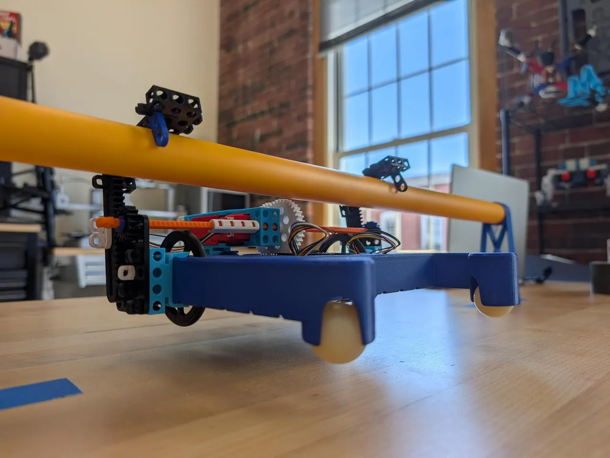

# Iron Acres Climber

Robot code for an [XRP](https://docs.wpilib.org/en/stable/docs/xrp-robot/index.html) robot, written in Java with [WPILib](https://docs.wpilib.org/), the library used in the FIRST Robotics Competition (FRC).

If you're new to robot programming, start here. This page covers what the robot does, how the code is organized, and how to run it and change it.

**Build the robot:** The 3D-printable parts for the climber are on Printables: [XBS Climber](https://www.printables.com/model/1676140-xbs-climber).

<p align="center">
  <a href="https://www.printables.com/model/1676140-xbs-climber">
    
  </a>
</p>

---

## What the robot can do

| Mechanism | Hardware | What it does |
|---|---|---|
| **Drivetrain** | Two drive motors and wheel encoders | Drives forward and backward, and turns |
| **Arm** | Servo on XRP **Servo port 1** | Swings to set angles while a button is held |
| **Climber** | Motor and encoder on XRP **Motor 4 port** | Climbs up or down while a button is held |

The climber uses a regular **motor**, not a servo. A servo turns to an angle you choose and holds it there. A motor just spins: you tell it *how fast* (from -1.0 to 1.0), not *where* to go. The motor's built-in **encoder** counts how far it has turned, so the code can tell how far the climber has moved.

---

## Controller layout

Plug a gamepad (such as an Xbox controller) into your computer. The code expects it in **port 0** of the Driver Station.

| Control | Action |
|---|---|
| Left stick, up/down | Drive forward and backward |
| Right stick, left/right (axis 2) | Turn |
| **A** (hold) | Arm moves to 45°, returns to 0° when released |
| **B** (hold) | Arm moves to 90°, returns to 0° when released |
| **Y** (hold) | Climber goes up, stops when released |
| **X** (hold) | Climber goes down at half speed, stops when released |
| USER button on the XRP board | Prints a message to the console (handy for checking your code is running) |

> Controllers don't all number their axes the same way. If turning is on the wrong stick, check the joystick view in the simulator window to see which axis moves, and change the axis number in `getArcadeDriveCommand()` in `RobotContainer.java`.

> ⚠️ **The climber has no automatic stop.** If you keep holding Y or X after the climber reaches the top or bottom, the motor keeps pushing and can strain the motor or the printed parts. Let go when it reaches the end.

---

## How the code is organized

This project uses WPILib's **command-based** style. The code is split into two kinds of pieces:

- **Subsystems** are the robot's physical parts. Each one owns its hardware and has simple methods like "set the speed".
- **Commands** are actions that use subsystems, such as "drive 10 inches" or "climb up".

```
src/main/java/frc/robot/
├── Main.java              Starts the program. You won't need to edit this.
├── Robot.java             Runs the robot loop and switches between modes (teleop, auto, ...).
├── RobotContainer.java    ★ Connects everything: creates subsystems and maps buttons to commands.
├── Constants.java         Shared numbers: the controller port and all the climber settings.
├── subsystems/
│   ├── Drivetrain.java    Drive motors, encoders, and gyro.
│   ├── Arm.java           Arm servo (Servo port 1).
│   └── Climber.java       Climber motor and encoder (Motor 4 port), plus climb up/down commands.
└── commands/
    ├── ArcadeDrive.java         Drive with the joysticks.
    ├── DriveDistance.java       Drive a set number of inches.
    ├── DriveTime.java           Drive for a set number of seconds.
    ├── TurnDegrees.java         Turn a set number of degrees.
    ├── TurnTime.java            Turn for a set number of seconds.
    ├── AutonomousDistance.java  Auto routine built from distance and degree commands.
    └── AutonomousTime.java      Auto routine built from timed commands.
```

**`RobotContainer.java` is usually where you start.** Its `configureButtonBindings()` method is where each button gets connected to a command.

### How the climber code works

`Climber.java` creates the motor and encoder, then offers two commands:

```java
public Command climbUpCommand() {
  return startEnd(() -> setSpeed(ClimberConstants.kClimbUpSpeed), this::stop)
      .withName("ClimbUp");
}
```

`startEnd` takes two jobs: one to do when the command **starts** (spin the motor) and one to do when it **ends** (stop the motor). In `RobotContainer.java`, the command is bound with `whileTrue`, so it runs only while the button is held:

```java
new JoystickButton(m_controller, 4).whileTrue(m_climber.climbUpCommand());
```

Let go of the button, the command ends, and the motor always stops.

The climber also sends its position to the dashboard every loop, as **Climber Position (revs)** (how many times the output shaft has turned).

### Port numbers

The labels on the XRP board don't match the numbers you use in code. Programmers usually start counting at 0, and the servos come after the motors:

| Port on the XRP board | Number in code | Encoder pins | Used for |
|---|---|---|---|
| Motor L | `0` | `4`, `5` | Left wheel |
| Motor R | `1` | `6`, `7` | Right wheel |
| Motor 3 | `2` | `8`, `9` | (free) |
| Motor 4 | `3` | `10`, `11` | **Climber** |
| Servo 1 | `4` | — | Arm |
| Servo 2 | `5` | — | (free) |

So `Climber` uses `new XRPMotor(3)` and `new Encoder(10, 11)`, and `Arm` uses `new XRPServo(4)`.

---

## Running the code

The XRP doesn't run Java itself. The code runs **on your computer** in simulation mode and sends commands to the XRP over Wi‑Fi.

1. **Install WPILib 2026** from the [WPILib installation guide](https://docs.wpilib.org/en/stable/docs/zero-to-robot/step-2/wpilib-setup.html). It includes VS Code, Java, and all the tools you need.
2. **Open this folder** in **WPILib VS Code**. Use the copy of VS Code that came with WPILib, not a regular VS Code install.
3. **Turn on the XRP** and connect your computer to its Wi‑Fi network. The code expects the XRP at `192.168.42.1`, which is set in `build.gradle`.
4. Press **Ctrl+Shift+P**, choose **WPILib: Simulate Robot Code**, and select **Sim GUI** if asked.
5. In the simulator window:
   - Under **System Joysticks**, drag your controller onto **Joystick[0]**.
   - Under **Robot State**, click **Teleoperated** to drive, or **Autonomous** to run the selected auto routine.

To choose an autonomous routine, use the **SendableChooser** drop-down on the dashboard (in the Sim GUI, look under **NetworkTables → SmartDashboard**). The climber's position shows up in the same place.

### Building from a terminal

To check that the code compiles without running it:

```
./gradlew build
```

If you see an odd error like `Type T not present`, Gradle is using the wrong version of Java. Point it at WPILib's Java first:

```
# PowerShell
$env:JAVA_HOME = "C:\Users\Public\wpilib\2026\jdk"
./gradlew build
```

---

## Common changes

All of the climber's settings live in `Constants.java`, inside `ClimberConstants`:

```java
public static final int kMotorChannel = 3;
public static final int kEncoderChannelA = 10;
public static final int kEncoderChannelB = 11;
public static final boolean kMotorInverted = true;
public static final double kClimbUpSpeed = 1.0;
public static final double kClimbDownSpeed = -0.5;
```

Change one thing at a time, then test. That way, if something breaks, you know what caused it.

### The climber goes the wrong way

If pressing Y makes the climber go **down**, flip `kMotorInverted` (`true` ↔ `false`).

### Change the climber speed

- `kClimbUpSpeed` sets the speed going up. Keep it between `0.0` and `1.0`.
- `kClimbDownSpeed` sets the speed going down. Keep it between `-1.0` and `0.0`.

### Move the climber to a different motor port

If you plug the climber into **Motor 3** instead, set `kMotorChannel = 2`, `kEncoderChannelA = 8`, and `kEncoderChannelB = 9`. See the [port numbers table](#port-numbers) above.

### Bind a new button

In `RobotContainer.java`, inside `configureButtonBindings()`:

```java
// Right bumper is button 6 on an Xbox controller.
JoystickButton rightBumper = new JoystickButton(m_controller, 6);
rightBumper.whileTrue(m_climber.climbUpCommand());
```

- `whileTrue` runs a command **while the button is held**, then ends it. The climber uses this.
- `onTrue` runs when the button is **pressed**.
- `onFalse` runs when the button is **released**.
- For the D-pad, use `new POVButton(m_controller, angle)`, where angle is 0 for up, 90 for right, 180 for down, and 270 for left.

### Challenge: add an automatic stop

The climber doesn't stop on its own at the top or bottom. Try fixing that:

1. Run the robot and watch **Climber Position (revs)** on the dashboard. Write down the number at the top and at the bottom.
2. Add those numbers to `ClimberConstants`.
3. In `Climber.java`, use `getPositionRevs()` to stop the motor when the climber goes past either number.

---

## Adding the climber to your own project

Already have your own XRP robot project, like one from another workshop? You can add this climber to it without starting over. You'll copy one file, paste in some settings, and connect two buttons.

### Before you start

Check that the climber won't clash with anything your robot already uses:

- **Motor 4 port:** the climber uses motor channel `3`. Search your code for `new XRPMotor(3)`. If something else already uses it, plug the climber into a free port and use that port's numbers from the [port numbers table](#port-numbers).
- **Encoder pins 10 and 11:** search for `new Encoder(10, 11)`. These pins belong to the Motor 4 port, so they'll only be taken if Motor 4 is.
- **The X and Y buttons:** check `configureButtonBindings()` in your `RobotContainer.java`. If X or Y already does something, pick different buttons in step 4.

Then plug the climber motor into the **Motor 4** port on the XRP.

### Step 1: Copy the subsystem

Copy [`src/main/java/frc/robot/subsystems/Climber.java`](src/main/java/frc/robot/subsystems/Climber.java) into the `subsystems` folder of your project.

Open it and check the first line of code:

```java
package frc.robot.subsystems;
```

This must match the folder the file is in. If your project uses the standard WPILib layout, it already does. If you get errors about the package, compare it with the first line of your own `Drivetrain.java` and make them match.

### Step 2: Add the climber settings

`Climber.java` reads its settings from `Constants.java`. Open **your** `Constants.java` and paste this block inside `public final class Constants { ... }`, next to any other `static class` blocks:

```java
  public static class ClimberConstants {
    // XRP motor channel 3 is the "Motor 4" port on the board. Its built-in
    // encoder is wired to DIO 10/11.
    public static final int kMotorChannel = 3;
    public static final int kEncoderChannelA = 10;
    public static final int kEncoderChannelB = 11;

    // Flip this if positive output drives the climber the wrong way
    public static final boolean kMotorInverted = true;

    // Standard XRP motor: 12 counts per motor rev * 48.75:1 gearbox
    public static final double kCountsPerRevolution = 585.0;

    public static final double kClimbUpSpeed = 1.0;
    public static final double kClimbDownSpeed = -0.5;
  }
```

> Watch the curly braces `{ }`. Every `{` needs a matching `}`. If VS Code underlines something in red after you paste, a brace is probably missing or extra.

### Step 3: Create the climber

Open your `RobotContainer.java`. Near the top, with the other `import` lines, add:

```java
import frc.robot.subsystems.Climber;
import edu.wpi.first.wpilibj2.command.button.JoystickButton;
```

(If an import is already there, you don't need to add it twice.)

Then, next to where your other subsystems are created (look for lines like `new Drivetrain()`), add:

```java
private final Climber m_climber = new Climber();
```

### Step 4: Connect the buttons

Still in `RobotContainer.java`, inside `configureButtonBindings()`, add:

```java
// Climber: hold Y (button 4) to climb up, hold X (button 3) to lower
new JoystickButton(m_controller, 4).whileTrue(m_climber.climbUpCommand());
new JoystickButton(m_controller, 3).whileTrue(m_climber.climbDownCommand());
```

`m_controller` is the name of the controller in this project. If yours has a different name, like `m_joystick`, use that instead. To use different buttons, change the `4` and `3`. On an Xbox controller, A is 1, B is 2, X is 3, Y is 4, left bumper is 5, and right bumper is 6.

> **Using `CommandXboxController`?** Some projects create the controller with `new CommandXboxController(0)` instead of `new Joystick(0)`. If yours does, skip the `JoystickButton` import and write the bindings like this instead:
> ```java
> m_controller.y().whileTrue(m_climber.climbUpCommand());
> m_controller.x().whileTrue(m_climber.climbDownCommand());
> ```

#### Why this looks different from the lifter

If you've added the [lifter from the High Goal robot](https://github.com/bb-frc-workshops/iron-acres-high-goal) before, you'll notice its buttons are connected differently:

```java
// Climber
new JoystickButton(m_controller, 4).whileTrue(m_climber.climbUpCommand());   // uses startEnd

// Lifter
new POVButton(m_controller, 0)
    .onTrue(new InstantCommand(() -> m_lifter.setAngle(Lifter.kUpAngleDeg), m_lifter));
```

This is because a motor and a servo need different instructions:

- **The climber uses a motor, which keeps spinning until it's told to stop.** If the climber used an `InstantCommand` (a command that runs once and finishes right away) to set the speed, the motor would keep spinning after you let go. So the climber uses `startEnd`, which does one job when the command starts (spin the motor) and another when it ends (stop the motor). `whileTrue` keeps the command running only while the button is held, so releasing the button ends the command and stops the motor.
- **The lifter uses a servo, which holds its own position.** You tell it an angle once, and it moves there and stays there by itself. The command only has to send that one instruction, so an `InstantCommand` is enough. `onTrue` runs it once when the button is pressed. After that, the command is done, but the servo keeps holding the angle.

| | Climber (motor) | Lifter (servo) |
|---|---|---|
| What you tell it | *How fast* to spin (a speed) | *Where* to go (an angle) |
| What happens on its own afterwards | Keeps spinning | Stays at that angle |
| Command | `startEnd`: start spinning, then stop at the end | `InstantCommand`: send the angle once |
| Binding | `whileTrue`: run while held, end when released | `onTrue`: run once when pressed |

A good rule to remember: if a mechanism keeps going until you stop it, your command must also handle stopping it. If it holds itself in place once it gets there, one instruction is enough.

You may also notice that the climber needed a step to add settings to `Constants.java`, while the lifter didn't. The lifter only has two settings (its up and down angles), so they live right inside `Lifter.java`. The climber has more: a motor port, two encoder pins, a direction, and two speeds. Keeping them together in `Constants.java` makes them easy to find and change in one place.

### Step 5: Test it

1. Build your code (see [Building from a terminal](#building-from-a-terminal)) and fix any red underlines.
2. Run the code and enable **Teleoperated**.
3. Tap **Y** briefly. The climber should move **up**. If it moves down, flip `kMotorInverted` in your `Constants.java`.
4. Check that **Climber Position (revs)** changes on the dashboard as the climber moves. If it stays at 0, double-check the encoder numbers in step 2.

Start with short taps. The climber has no automatic stop, so let go before it reaches the end.

---

## Learn more

- [WPILib documentation](https://docs.wpilib.org/en/stable/): the main reference
- [Getting started with the XRP](https://docs.wpilib.org/en/stable/docs/xrp-robot/index.html)
- [Command-based programming](https://docs.wpilib.org/en/stable/docs/software/commandbased/index.html)
- [Java basics for FRC](https://docs.wpilib.org/en/stable/docs/software/basic-programming/java-gc.html)
